<p align="center">
  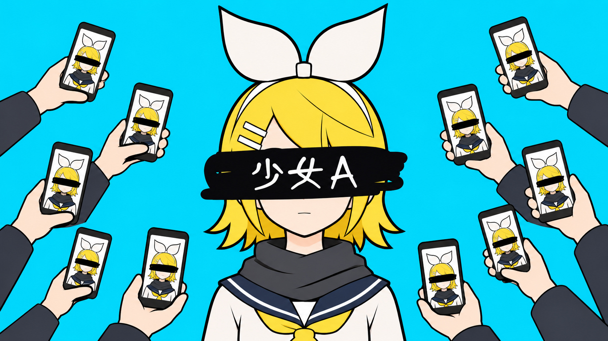
</p>

<h1 align="center">Fable5.5-YoungGirlA</h1>

<p align="center">
  <b>Who Is Girl A? · A fan-made MV for siinamota's “Young Girl A”</b><br>
  Everyone is talking about Girl A. Nobody is asking about her.
</p>

<p align="center"><a href="README.md">中文</a> · English</p>

<p align="center">
  
  
  
  
  
</p>

<p align="center">Song and lyrics: <b>siinamota</b> · Vocals: <b>Kagamine Rin</b><br>
MV: <b>RepressedAlliance × Claude Code × Codex</b></p>

## Watch

<table>
  <tr>
    <td width="33%">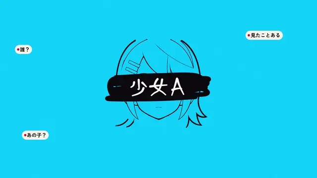</td>
    <td width="33%">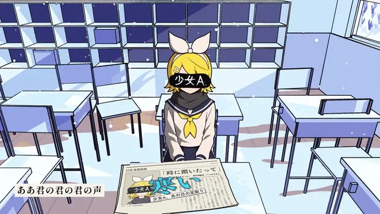</td>
    <td width="33%">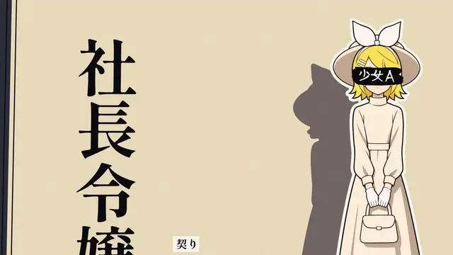</td>
  </tr>
  <tr>
    <td align="center"><sub>Headlines and rumours</sub></td>
    <td align="center"><sub>From a desk to a city</sub></td>
    <td align="center"><sub>Fourteen rumours, the same girl</sub></td>
  </tr>
</table>

**[Watch the complete MV on Bilibili](https://www.bilibili.com/video/BV1CU4q6EELF/)** · 4:02 · 1920×1080 · 30 fps

## The story

A girl appears in the news under an anonymous label: “Girl A.” Magazines, comments, rankings and bystanders assign her conflicting identities. The more people define her, the harder it becomes to see the person behind the label.

The film moves from news feeds into a school gate, shoe lockers, a train and a classroom, gradually approaching her own life. Behind the black bar, she remains a person the headlines cannot describe.

This is the film's own fictional interpretation, not a reconstruction of the songwriter's life. Early plans differ from the finished film; the current code and the frame table in `src/assemble_full.py` describe the implementation.

## Learn from the production

The detailed production documents are in Chinese. These entry points connect the decisions to their implementation:

| Question | Start here |
|---|---|
| How did a theme become a storyboard? | [Production notes](docs/制作手记.md), [creative plan](docs/新方案_谁是少女A.md), [full storyboard](docs/全片分镜.md) |
| How were the character and motion assets made? | [Assets and prompts](docs/素材与提示词.md), [model sheet](docs/人设_定稿_c.png), [prompt library](work/gen/prompts.py) |
| How does the 3D-to-flat-animation pipeline work? | [Production workflow](docs/制作流程.md), [Blender scenes](src/three/), [NPR painters](src/npr/) |
| What changed after review? | [Root-cause checklist](docs/问题根因清单.md), [version-five feedback](docs/全片修改清单5.md), [ending redesign](docs/结尾重做.md) |
| What is public and what must I provide? | [Asset scope](docs/素材与提示词.md#公开范围), [NOTICE](NOTICE.md) |

See the [documentation index](docs/README.md) for the original planning and revision records. Historical instructions describe their production stage; they are not the current setup guide.

## Gallery

<table>
  <tr>
    <td width="33%">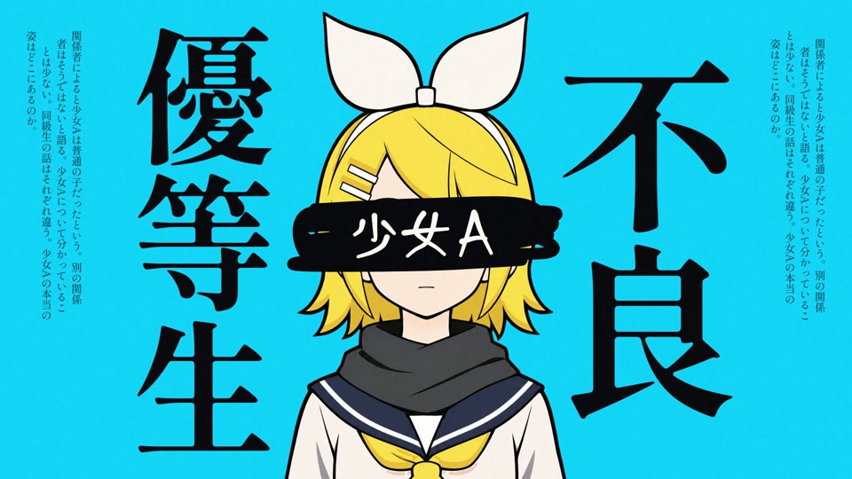</td>
    <td width="33%">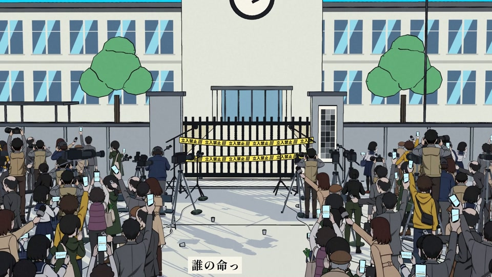</td>
    <td width="33%">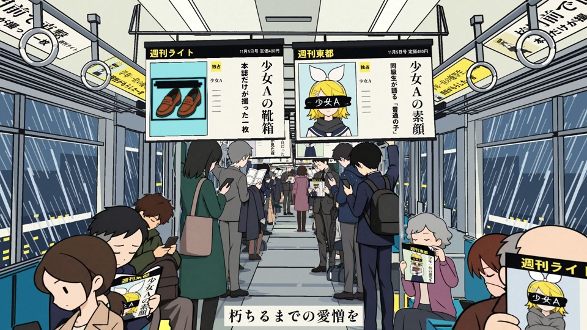</td>
  </tr>
  <tr>
    <td width="33%">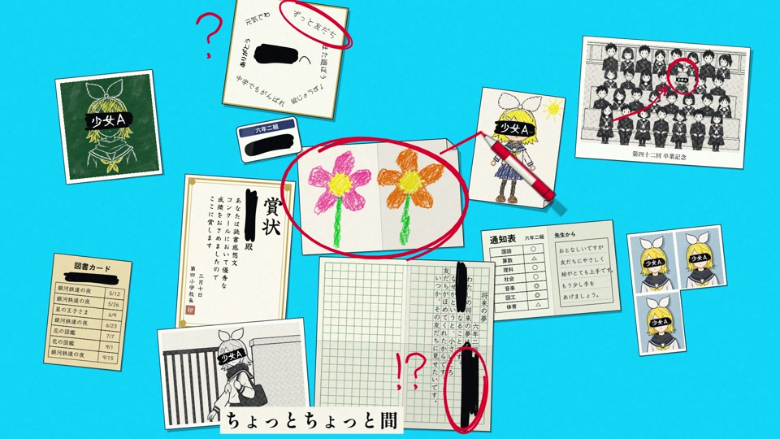</td>
    <td width="33%">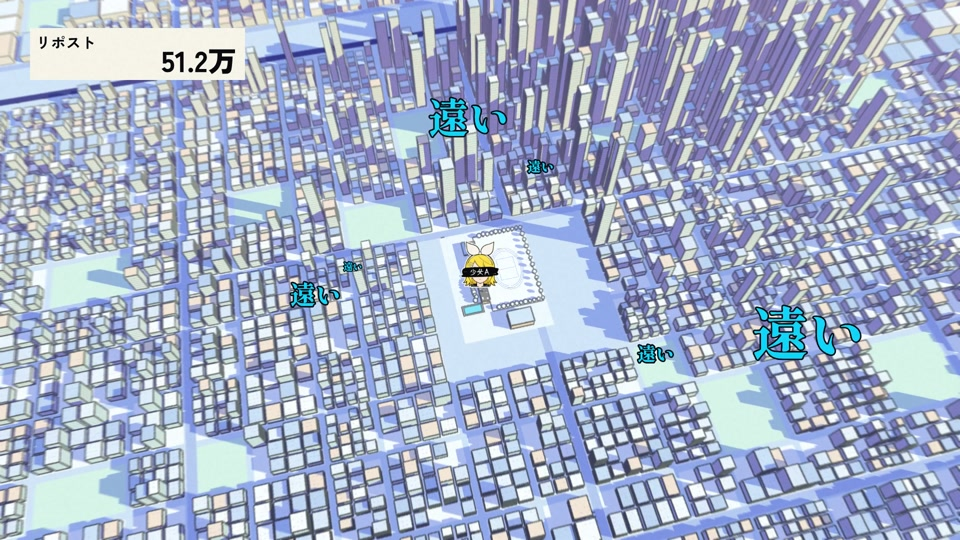</td>
    <td width="33%">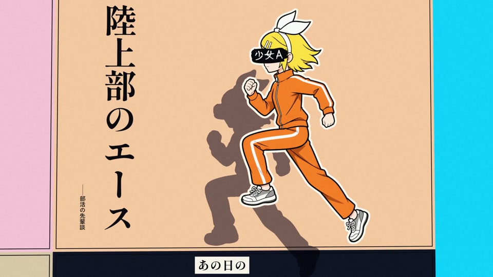</td>
  </tr>
  <tr>
    <td width="33%">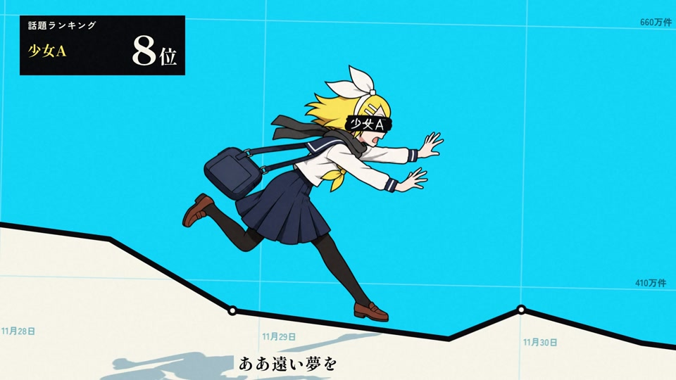</td>
    <td width="33%">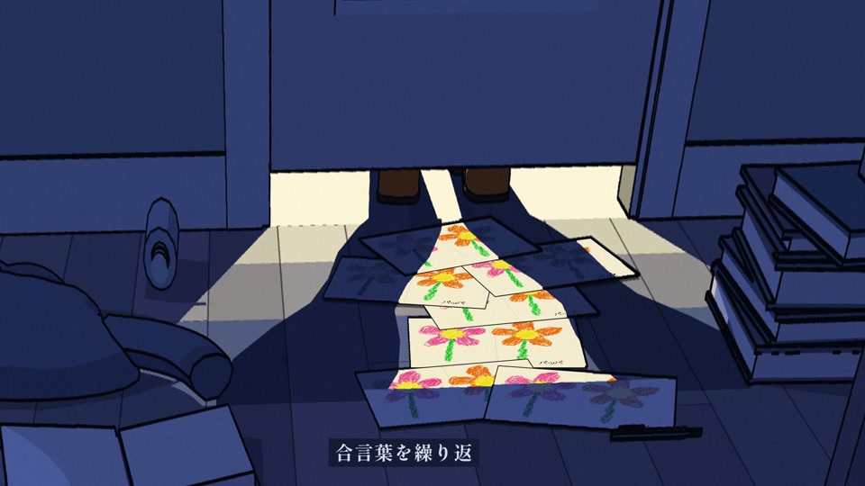</td>
    <td width="33%">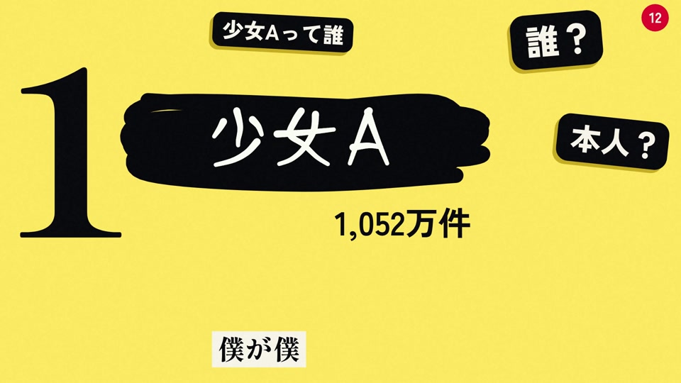</td>
  </tr>
</table>

## How it works

- **2D:** Skia draws interfaces, magazines, comments, paper, rankings and forms. HarfBuzz shapes Japanese text; the engine measures it before placement.
- **3D:** Blender Cycles produces geometry/data passes. Python painters turn EXR normals, positions and object/material IDs into flat colour, hard shadows and ink outlines.
- **Characters:** Codex generates whole character drawings with the same model sheet attached. Code cuts, aligns, swaps, deforms and composites the selected pictures.
- **Timing:** a shared song clock combines a beat grid with Japanese character timing mapped from a user-provided romaji karaoke ASS file.
- **Assembly:** nine 3D shot groups feed 21 rendered sections, which are joined using a global 30 fps frame table and one continuous song track.

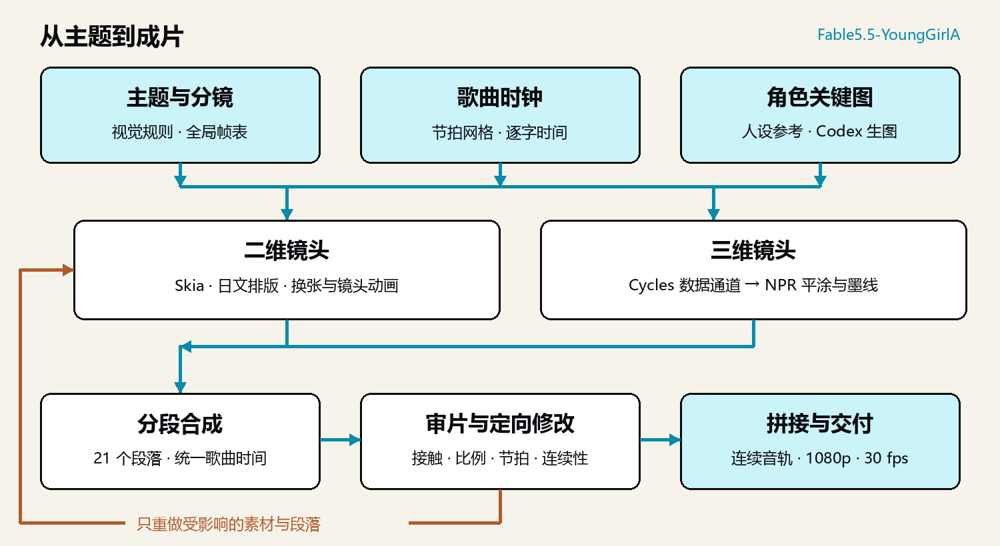

Reusable references include [typesetting](src/typo/engine.py), [the 2D engine](src/engine.py), [EXR compositing](src/npr/comp.py), [eye animation](src/clips/eye_anim.py), [writing the final name](src/clips/s13b.py) and [section assembly](src/assemble_full.py).

## Setup and limits

You can study the production without installing or running anything. To render, the original environment used Windows, Python 3.12, Blender 5.2 and FFmpeg. `requirements.txt` records the main versions installed during production, not a cross-platform lockfile. GPU painting additionally needs a suitable PyTorch build.

```powershell
git clone https://github.com/RepressedAlliance/Fable5.5-YoungGirlA.git
cd Fable5.5-YoungGirlA
py -3.12 -m venv .venv
.venv\Scripts\python -m pip install -r requirements.txt
.venv\Scripts\python src\tools\fetch_fonts.py
```

You must supply the song as `input/song.mp4`, a matching romaji karaoke file as `input/lyrics.ass`, and Japanese lyrics as `work/analysis/lyrics_ja.txt`. The alignment script is not automatic speech recognition. Line segmentation and lyric indices must match the film's code; see [the workflow](docs/制作流程.md#环境与输入).

After preparing the lyrics:

```powershell
New-Item -ItemType Directory -Force work\analysis | Out-Null
Copy-Item data\audio.json work\analysis\audio.json
.venv\Scripts\python src\analysis\lyric_timing.py
.venv\Scripts\python src\tools\preview.py c1 Opening 8
```

The current full-film entry point is `src/make_full.py`, with section rendering and assembly in `src/assemble_full.py`. It expects the original GPU-oriented environment and can create over 100 GB of intermediate data. Its output is `out/少女A_full.mp4`; the published delivery file was compressed separately.

`make_all.py`, `assemble.py` and `finish_v*.py` are earlier demo/stage scripts. Selected scripts in `work/eye/key6/` preserve the historical asset process; not all of their candidate inputs are distributed. The finished selected assets are included under `assets/gen/`.

This is a song-specific production, not a drop-in generator: replacing the audio requires new timing, layout and shot decisions. Regenerating character images also requires your own tool access and usage quota.

## Credits and licensing

- RepressedAlliance: direction, review and feedback; Claude Code: concept, storyboard, code, scenes and compositing; Codex: character artwork generated with reference sheets.
- Song and lyrics: siinamota; vocals: Kagamine Rin.
- Source code: [MIT](LICENSE). Repository artwork and documents: **CC BY-NC 4.0**, subject to applicable character rights.
- Kagamine Rin: Crypton Future Media, INC.; see the [Piapro Character License](https://piapro.net/intl/license.html).
- Fonts: their respective SIL Open Font Licenses; downloaded separately from Google Fonts.
- The project keeps its release name. Available production records identify Claude Opus 5.5; the repository name is not verification of model identity.

The song, complete lyrics, third-party karaoke files, full movie, account information and original chat logs are not distributed. See [NOTICE](NOTICE.md). This is an independent, unofficial fan project.
