<p align="center">
  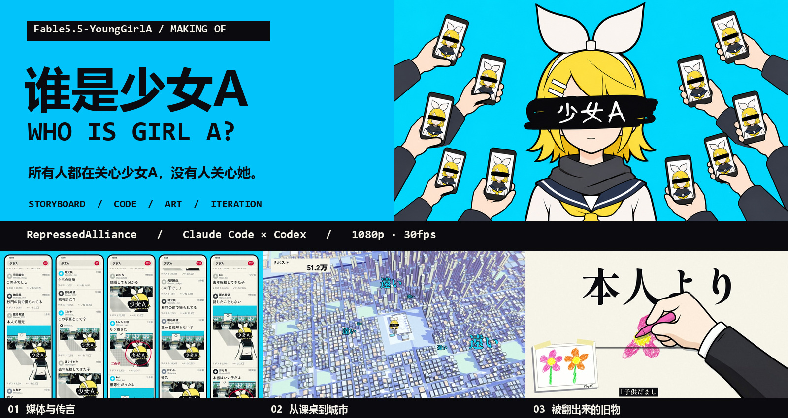
</p>

<h1 align="center">Fable5.5-YoungGirlA</h1>

<p align="center">
  <b>《少女A》同人 MV · 谁是少女A</b><br>
  所有人都在关心少女A，没有人关心她。
</p>

<p align="center">中文 · <a href="README.en.md">English</a></p>

<p align="center">
  
  
  
  
  
</p>

<p align="center">
  原曲／作词作曲 <b>椎名もた</b> · 演唱 <b>鏡音リン</b><br>
  MV <b>压抑同盟 RepressedAlliance</b> × <b>Claude Code</b> × <b>Codex</b>
</p>

---

## 成片

<table>
  <tr>
    <td width="33%">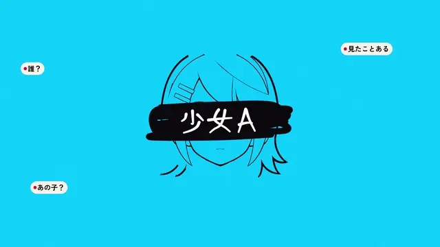</td>
    <td width="33%">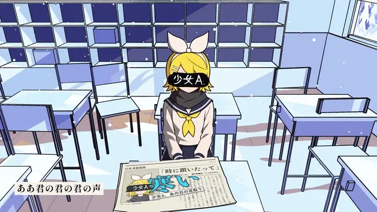</td>
    <td width="33%">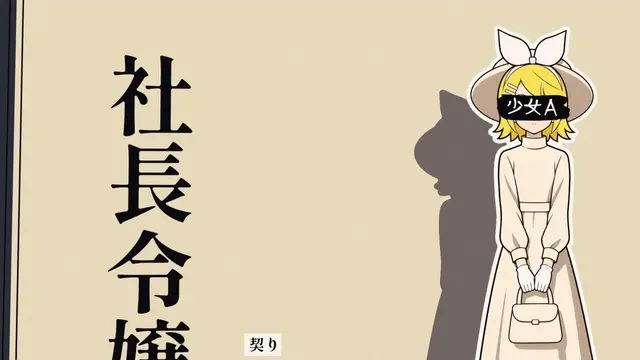</td>
  </tr>
  <tr>
    <td align="center"><sub>外界：标题、标签与传言</sub></td>
    <td align="center"><sub>距离：从一张课桌到整座城市</sub></td>
    <td align="center"><sub>身份：十四种传言，还是同一个她</sub></td>
  </tr>
</table>

**[▶ 在哔哩哔哩看完整 MV](https://www.bilibili.com/video/BV1CU4q6EELF/)** · 4 分 02 秒 · 1920 × 1080 · 30 fps

## 这支片子讲什么

新闻里有个女孩，只被称为“少女A”。杂志、评论、热搜和身边的人不断替她定义身份：优等生、不良、运动员、偶像，甚至外星人。说法越多，真正的她反而越模糊。

片子从信息流走进校门、鞋柜、电车和教室，逐渐接近她自己的生活。黑条之下，她究竟是谁？她的故事，藏在这个代号后面。

这是本片的同人叙事，不是对原作者生平的还原。早期方案与成片有差异，**实际段落和实现以 `src/assemble_full.py` 的帧表及当前代码为准**。

## 想参考制作过程，从这里开始

| 你想了解 | 建议入口 |
|---|---|
| 一支 MV 怎样从主题变成镜头 | [制作手记](docs/制作手记.md) → [创作方案](docs/新方案_谁是少女A.md) → [全片分镜](docs/全片分镜.md) |
| 怎样保持人物画风、做连续动作和开眼 | [素材与提示词](docs/素材与提示词.md) → [人设提示词](docs/人设_提示词.txt) → [生成提示词库](work/gen/prompts.py) |
| 怎样把 3D 渲染成平涂动画 | [制作流程](docs/制作流程.md) → [场景搭建](src/three/) → [数据通道上色](src/npr/) |
| 怎样把“这里不好看”变成可执行的修改 | [问题根因清单](docs/问题根因清单.md) → [第五版反馈](docs/全片修改清单5.md) → [结尾重做](docs/结尾重做.md) |
| 怎样安装、预览、重渲一个段落 | [环境与命令](docs/制作流程.md#环境与输入) |
| 已公开什么、还需要自己准备什么 | [素材清单与边界](docs/素材与提示词.md#公开范围) · [权利说明](NOTICE.md) |

完整文档索引见 [docs/README.md](docs/README.md)。这个仓库既保存作品，也保留形成它的方法和取舍。

## 画面

<table>
  <tr>
    <td width="33%">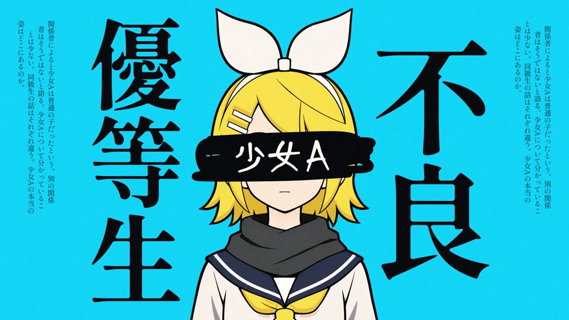</td>
    <td width="33%">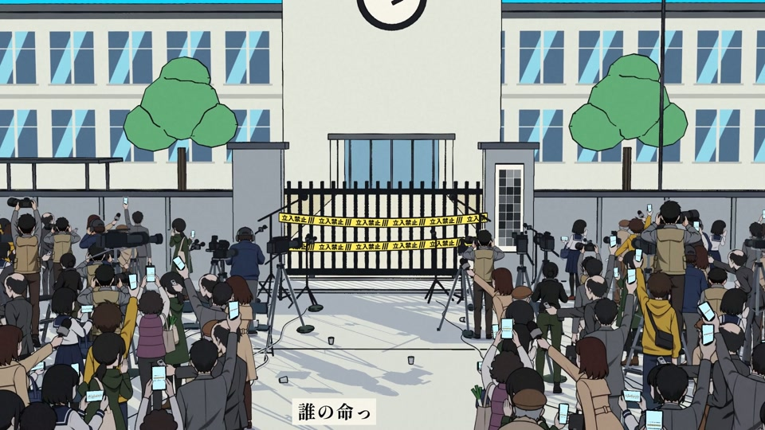</td>
    <td width="33%">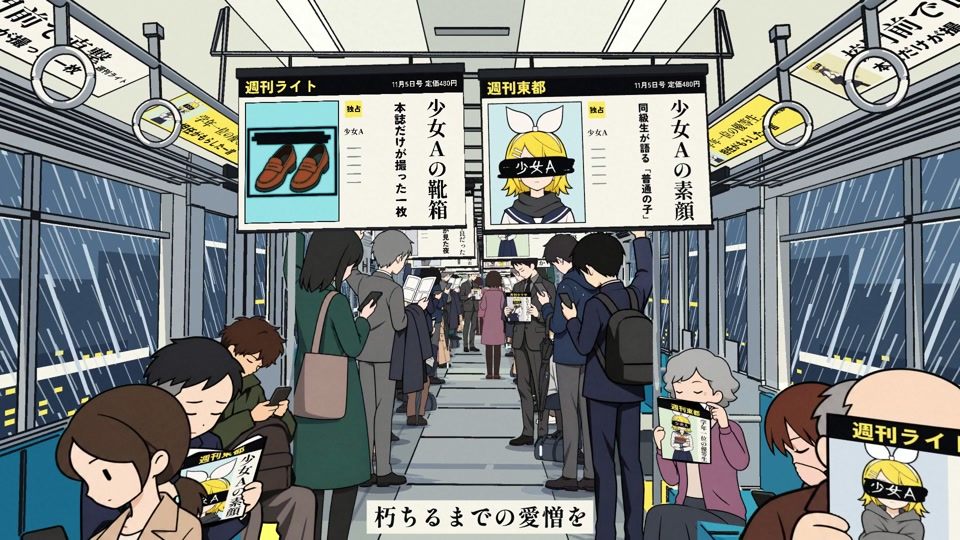</td>
  </tr>
  <tr>
    <td width="33%">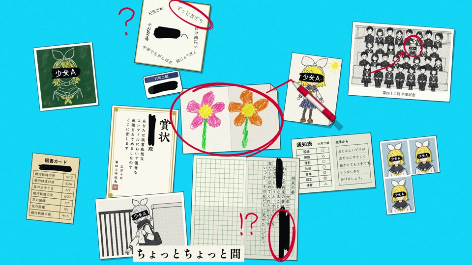</td>
    <td width="33%">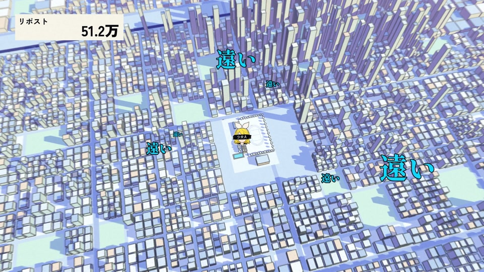</td>
    <td width="33%">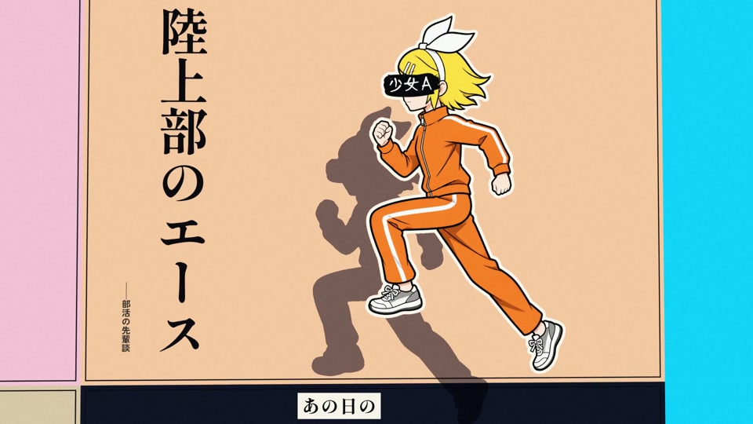</td>
  </tr>
  <tr>
    <td width="33%">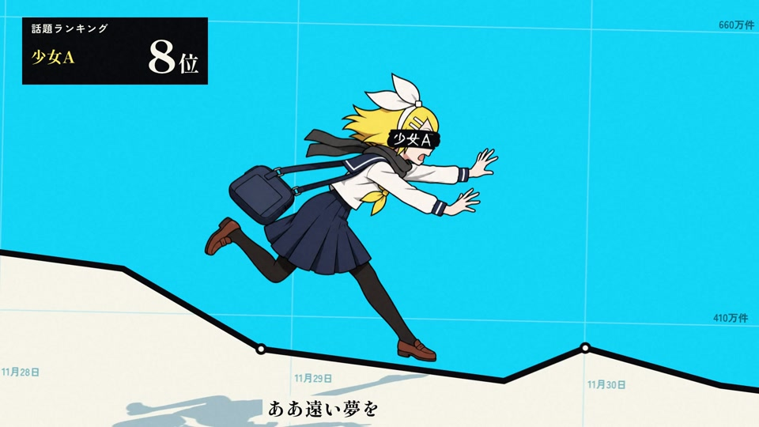</td>
    <td width="33%">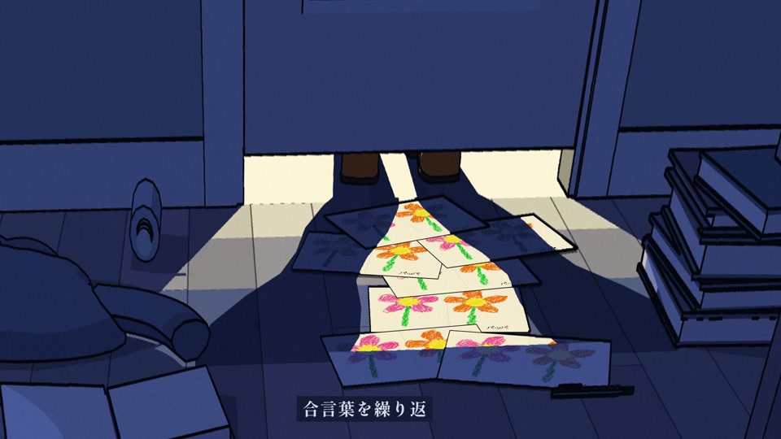</td>
    <td width="33%">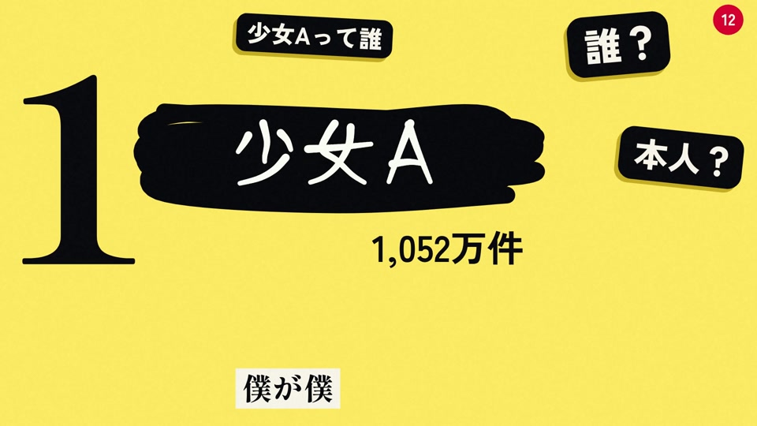</td>
  </tr>
</table>

## 画面是怎样做出来的

- **二维部分用代码排演。** Skia 绘制杂志、手机信息流、榜单、评论、纸张和表格；用同一套字体测量、缓动和运动模糊完成动画。
- **三维部分先搭场景，再上色。** Blender Cycles 输出法线、位置、材质和物体编号等 EXR 通道，Python 合成器把它们画成硬边阴影、平涂和墨线。修改颜色与部分线条时可以重上色，不必重新计算几何。
- **人物主体由 Codex 带人设图生成。** 先固定脸型、比例、线条和色板，再生成姿势与动作关键图。代码负责抠图、对齐、换张、形变和合成；角色不是程序凭空画出的几何拼图。
- **歌词和动作共用歌曲时钟。** 音乐网格、卡拉 OK 音节轴和日文逐字对应关系进入 `timeline.py`；镜头、换张、纸带字幕与重音按歌曲时间排布。
- **正式全片分为 21 个渲染段落。** 三维部分组织为 9 组镜头；分段出片后按全局帧表拼接，再接入一条连续的原曲音轨。

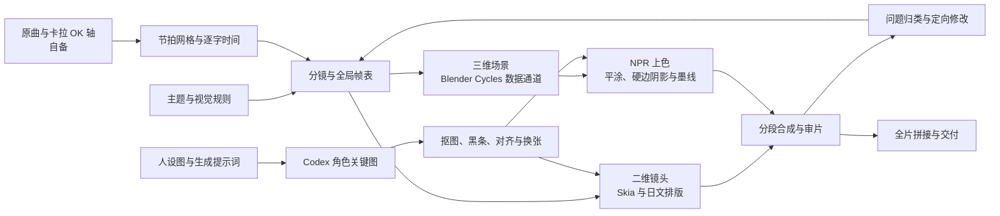

具体命令、输入输出、正式与历史脚本的区别，见 [制作流程](docs/制作流程.md)。

## 可以单独参考的部分

| 部分 | 做法 | 代码 |
|---|---|---|
| 日文逐字与竖排 | HarfBuzz shaping、Skia 字形轮廓、测量后适配文本框 | [src/typo/engine.py](src/typo/engine.py)、[src/engine.py](src/engine.py) |
| 节拍与歌词时钟 | 固定节拍网格；把罗马音 ASS 音节轴映射到日文字符 | [src/analysis/](src/analysis/)、[src/timeline.py](src/timeline.py) |
| 平涂三维 | 几何与着色分离，用世界坐标、法线及编号处理阴影和轮廓 | [src/three/kit.py](src/three/kit.py)、[src/npr/comp.py](src/npr/comp.py) |
| 人物素材处理 | 抠背景、处理边缘、平涂整理、人工定位遮眼黑条 | [src/art/](src/art/)、[work/gen/bars_c.py](work/gen/bars_c.py) |
| 连续动作 | 同一角色的关键图对齐后换张，配合镜头和节拍 | [src/clips/s07x.py](src/clips/s07x.py)、[src/clips/c6.py](src/clips/c6.py) |
| 开眼与结尾 | 原画中的虹膜、高光、眼睑、风中头发分层，再按音节编排 | [src/clips/eye_anim.py](src/clips/eye_anim.py)、[src/clips/c6.py](src/clips/c6.py) |
| 写下名字 | 手、笔尖和笔画路径共同约束，不用整段文字直接淡入 | [src/clips/s13b.py](src/clips/s13b.py) |
| 分段出片与审片 | 指定歌曲时间抽帧；只重渲改动的段落，再统一拼接 | [src/tools/preview.py](src/tools/preview.py)、[src/assemble_full.py](src/assemble_full.py) |

## 开始参考或重跑

**只想研究方法，直接读文档和代码即可，不需要先装 Blender 或生成任何图片。**

要实际出帧，原环境为 Windows、Python 3.12、Blender 5.2、FFmpeg；GPU 上色另需适配本机的 PyTorch。依赖版本来自制作环境，不代表已在所有平台验证。

```powershell
git clone https://github.com/RepressedAlliance/Fable5.5-YoungGirlA.git
cd Fable5.5-YoungGirlA
py -3.12 -m venv .venv
.venv\Scripts\python -m pip install -r requirements.txt
.venv\Scripts\python src\tools\fetch_fonts.py
```

原曲、日文歌词和卡拉 OK 轴需要自备。先按 [环境与输入](docs/制作流程.md#环境与输入) 准备歌曲数据，再从一张二维预览开始：

```powershell
.venv\Scripts\python src\tools\preview.py c1 Opening 8
```

这是为一首歌定制的制作工程。分镜、行号、节拍和部分输入格式都与《少女A》绑定，**换歌需要重新分析和编排**，不是替换音频就能生成另一支 MV。全片重渲会产生大量 EXR 和 PNG 中间文件，建议先读流程，再决定需要重跑哪一部分。

## 目录

```text
Fable5.5-YoungGirlA/
├── README.md / README.en.md      成片展示与学习入口
├── requirements.txt             制作环境的 Python 依赖
├── NOTICE.md                    素材、角色与歌曲权利说明
├── docs/                        文档索引、制作流程、手记、原始分镜及修改记录
│   └── images/                  成片剧照与静音动图
├── src/
│   ├── analysis/                音乐分析、节拍网格、ASS → 日文逐字轴
│   ├── clips/                   二维镜头、3D 镜头叠加层、开眼与尾奏
│   ├── three/                   Blender 场景、机位、镜头共享参数
│   ├── npr/                     EXR 通道读取、平涂、阴影与墨线
│   ├── art/                     人物抠图、边缘、黑条和局部处理
│   ├── typo/                    日文字形排版
│   ├── tools/                   预览、字体下载、生图调用及检查工具
│   ├── timeline.py              歌曲时间与歌词访问
│   ├── make_full.py             正式全片渲染入口
│   └── assemble_full.py         21 段帧表、分段渲染与全片拼接
├── assets/
│   ├── gen/                     角色图、分层、结尾原画与必要道具图
│   └── tex/                     场景贴图
├── data/                        数值节拍数据与字体下载清单
├── work/gen/                    选入版本库的生成提示词和黑条定位表
├── work/eye/                    选入版本库的开眼提示词、结尾生成与处理脚本
├── input/                       自备原曲和卡拉 OK 轴，不随仓库分发
└── out/                         本地输出，不随仓库分发
```

## 署名与许可

- **MV：** 压抑同盟 RepressedAlliance（方向、审片与反馈）× Claude Code（构想、分镜、代码、场景与合成）× Codex（带人设参考的角色原画）。
- **原曲：**《少女A》，作词作曲 椎名もた，演唱 鏡音リン。
- **代码：** [MIT](LICENSE)。本仓库图片和文档：**CC BY-NC 4.0**；借用代码与借用角色图的许可不同。
- **角色：** 鏡音リン相关权利属于 Crypton Future Media, INC.，使用角色图还须遵守其适用条款。
- **字体：** Google Fonts 各字体的 SIL Open Font License，由脚本下载，不打包进 Git。
- **项目名称：** 沿用发布时的名称；现存制作运行记录标记为 Claude Opus 5.5，不将仓库名作为模型身份的证明。

歌曲音频、完整歌词、第三方卡拉 OK 文件、完整成片及原始聊天日志不在仓库中。详细范围见 [NOTICE.md](NOTICE.md)。本项目为独立、非官方同人创作。
